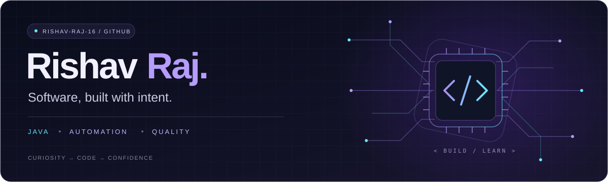

  

  <strong>Application Developer at IBM · Full Stack Quality Engineering</strong> 
  Java &amp; test automation today. Building toward software engineering.

  
  
  

## `01` / About me

I'm Rishav, an Application Developer at IBM working in Full Stack Quality Engineering. I write Java automation, investigate failures, and validate end-to-end application behavior and data.

I'm working toward software engineering roles where I can build product features and bring that same attention to reliability. Outside my day-to-day work, I practise data structures and algorithms and explore AI/ML.

## `02` / Technical toolkit

**Languages & fundamentals**

Object-oriented programming · Data structures & algorithms · Design patterns

**Testing & application quality**

Regression testing · Test debugging · Root-cause investigation · CI regression workflows

**Data, builds & collaboration**

Additional foundations & development environment

- **Web basics:** HTML, CSS, JavaScript
- **Command line:** Linux/Unix basics
- **Editors:** IntelliJ IDEA, VS Code
- **Currently exploring:** AI/ML

## `03` / Current work

**IBM — Application Developer (Full Stack Quality Engineer)** 
October 2025 – present

- Develop and maintain automated test suites with **Java and Selenium WebDriver**.
- Write **Cucumber/Gherkin** scenarios and Java step definitions using a Page Object Model framework.
- Trace failing tests and application defects through **logs and CI regression runs**.
- Validate end-to-end application data using **MySQL queries**.
- Work with developers, product managers, and QA in an **Agile/Scrum team**.

## `04` / Beyond the workday

**Problem solving** — practising DSA in C++ and Java. 
**Learning** — exploring AI/ML alongside software development. 
**Education** — B.Tech in Computer Science & Engineering, Chandigarh Engineering College, Jhanjeri (2021–2025).

---

  Write with intent. Debug with evidence. Build for reliability.

